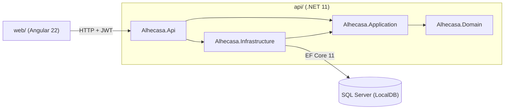

# Arquitectura

Este documento describe las capas del sistema, las decisiones tomadas y sus razones. Para instalar y ejecutar, consulta [README.md](README.md); para los endpoints, [api.md](api.md).

## Visión general



## Backend: Clean Architecture

Cada capa es un proyecto separado de la solución `api/Alhecasa.sln`. **Las dependencias solo apuntan hacia adentro**: `Api → Infrastructure → Application → Domain`. Domain no depende de ningún proyecto ni paquete.

### Alhecasa.Domain

Reglas de negocio y entidades, sin dependencias externas.

- `BaseEntity`: `Id` (Guid versión 7, generado en código), auditoría (`CreatedAt`, `UpdatedAt`) y borrado lógico (`IsDeleted`, `DeletedAt`).
- `User`: persona con acceso. Tiene rol, inmobiliaria opcional, estado activo y último acceso.
- `Agency`: inmobiliaria. Es el límite de aislamiento de datos (tenant).
- `UserRole`: `PlatformAdmin`, `AgencyAdmin`, `Client`.
- `DomainException`: violación de una regla del dominio.

**Invariante del dominio** (en `User`): `PlatformAdmin` no pertenece a ninguna inmobiliaria; `AgencyAdmin` siempre pertenece a una; `Client` puede pertenecer a una o ser un anunciante particular (sin inmobiliaria).

Las entidades tienen constructores y setters privados: el estado solo cambia mediante métodos que validan la regla anterior.

### Alhecasa.Application

Casos de uso y contratos. Depende solo de Domain (y de FluentValidation).

- `Abstractions/`: interfaces que Infrastructure implementa (`IUserRepository`, `IAgencyRepository`, `IUnitOfWork`, `IPasswordHasher`, `IJwtTokenGenerator`) y la interfaz `ICurrentUser`, que Api implementa a partir del JWT.
- `Auth/`, `Users/`, `Agencies/`: DTOs (`record`), validadores y servicios de aplicación (`AuthService`, `UserService`, `AgencyService`).
- `Common/`: `PagedResult<T>` y las excepciones de aplicación (`NotFoundException`, `ConflictException`, `ForbiddenException`, `AuthenticationFailedException`).

Aquí viven las **reglas de autorización** (quién puede hacer qué con los usuarios), de modo que no dependen de HTTP ni de la base de datos.

### Alhecasa.Infrastructure

Detalles técnicos. Depende de Application.

- `Persistence/`: `AlhecasaDbContext` (implementa `IUnitOfWork`), `Configurations/` (una clase por entidad), `Repositories/`, `Migrations/` y `Seeding/`.
- `Identity/`: `Pbkdf2PasswordHasher`, `JwtTokenGenerator` y `JwtOptions`.
- `DependencyInjection.cs`: registra todo con `AddInfrastructure(configuration)`.

### Alhecasa.Api

Capa de entrega. Depende de Application e Infrastructure (esta última solo para registrar servicios en `Program.cs`).

- `Controllers/`: `AuthController`, `UsersController`, `AgenciesController`. Son delgados: delegan en los servicios de aplicación.
- `Middleware/GlobalExceptionHandler`: convierte excepciones en `ProblemDetails`.
- `Services/CurrentUser`: implementa `ICurrentUser` leyendo los claims.
- `OpenApi/`: esquema Bearer en el documento OpenAPI.
- `Program.cs`: composición (autenticación, autorización, CORS, límite de intentos, OpenAPI, salud).

## Decisiones de diseño

### Multiinmobiliaria con filtros globales de EF Core

Cada consulta a `Users` y `Agencies` pasa por un **filtro global** que aplica el borrado lógico y el aislamiento:

- `PlatformAdmin`: ve todo.
- Cualquier otro usuario: ve los registros de su inmobiliaria y, siempre, su propio usuario.
- Sin usuario autenticado: no ve nada.

Los valores del usuario actual vienen de `ICurrentUser`, que el `DbContext` consulta en cada consulta. Esto es **defensa en profundidad**: aun si un servicio olvidara filtrar, la base no devuelve datos de otra inmobiliaria. Un `AgencyAdmin` que pide un usuario de otra inmobiliaria recibe `404`, no `403`, para no revelar que existe.

`IgnoreQueryFilters()` se usa en tres lugares, todos justificados:
1. **Login:** todavía no hay usuario autenticado.
2. **Unicidad del correo:** debe ser global, no por inmobiliaria.
3. **Datos iniciales (seeding).**

Cualquier nuevo uso de `IgnoreQueryFilters()` debe revisarse con cuidado.

### Usuarios y contraseñas propios (sin ASP.NET Identity)

Se eligió una entidad `User` propia para mantener **Domain limpio**; ASP.NET Identity acoplaría Domain e Infrastructure a su modelo. Las contraseñas se guardan con **PBKDF2-HMAC-SHA512** (incluido en .NET): 210 000 iteraciones (recomendación de OWASP), sal aleatoria de 16 bytes por contraseña y comparación en tiempo constante. El formato almacenado es `PBKDF2$SHA512$iteraciones$sal$hash`, lo que permite subir las iteraciones en el futuro sin romper los hashes existentes.

Para no revelar qué correos están registrados, el login responde siempre con el mismo mensaje y, si el usuario no existe, ejecuta una verificación contra un hash ficticio para igualar el tiempo de respuesta.

### JWT

- Algoritmo HMAC-SHA256. Claims: `sub`, `email`, `name`, `role`, `agency_id`, `jti` e `iat`.
- Vigencia de 60 minutos, con tolerancia de reloj de 30 segundos.
- La clave de firma no está en el código ni en `appsettings.json`: se obtiene de user-secrets o variables de entorno, y se valida al iniciar (mínimo 32 caracteres).
- Se desactiva el mapeo automático de claims (`MapInboundClaims = false`) para usar nombres cortos y estables.
- **Revalidación en cada petición:** los permisos se toman de los claims del token, pero tras verificar la firma, `JwtBearerEvents.OnTokenValidated` (`Api/Authentication/SessionRevalidation.cs`) consulta la base mediante `ISessionValidator` y rechaza con `401` si el usuario ya no existe, está desactivado o eliminado, cambió de rol o de inmobiliaria, o su inmobiliaria fue eliminada o desactivada. El costo es una consulta ligera por petición autenticada (proyección de tres columnas con `IgnoreQueryFilters`, porque en ese momento el usuario de la solicitud todavía no está establecido). A cambio, el acceso se revoca en la siguiente petición y no al vencer el token.

### Seguridad por defecto

- **Política de autorización por defecto:** todo endpoint exige autenticación, salvo los marcados con `[AllowAnonymous]` (login y `/health`).
- **Roles en los controladores:** `UsersController` y `AgenciesController` exigen `PlatformAdmin` o `AgencyAdmin`.
- **Límite de intentos:** 10 por minuto por IP en el login.
- **CORS:** lista explícita de orígenes desde configuración; solo los encabezados y métodos necesarios.
- **Cabeceras:** `X-Content-Type-Options`, `X-Frame-Options` y `Referrer-Policy`. En producción se activan HSTS y la redirección a HTTPS.
- **Errores:** `ProblemDetails` (RFC 9457). El detalle de un error interno (500) nunca se envía al cliente; solo se registra.
- **Búsqueda:** los caracteres comodín de `LIKE` se escapan para que el texto del usuario no altere la consulta.
- **Validación:** FluentValidation en cada solicitud de entrada; paginación acotada (máximo 100 por página).

### Persistencia

- **Borrado lógico** en todas las entidades. El correo es único solo entre usuarios no eliminados (índice filtrado `[IsDeleted] = 0`), de modo que se puede reutilizar tras un borrado.
- **Identificadores Guid v7:** únicos y ordenables por tiempo, y se generan en código.
- **Rol como texto** (`nvarchar(30)`): la base es legible y estable ante cambios del orden del enum.
- **Fechas** como `datetimeoffset`, con un `TimeProvider` inyectable (facilita las pruebas).
- **Auditoría** automática en `SaveChanges` (`CreatedAt`, `UpdatedAt`).
- **Resiliencia:** reintentos ante fallos transitorios de SQL Server.
- **Migraciones** en `Infrastructure/Persistence/Migrations`, aplicadas con `dotnet ef database update`. En Desarrollo también se pueden aplicar al arrancar.

### Sin MediatR ni mapeadores

Se evitó MediatR 15 porque requiere licencia comercial, y para este alcance bastan servicios de aplicación por caso de uso. El mapeo entre entidades y DTOs es manual: es explícito y no añade dependencias.

### Convenciones

- Nullable habilitado y advertencias como errores en toda la solución (`Directory.Build.props`).
- Versiones de paquetes centralizadas en `Directory.Packages.props`.
- Se desactivan las reglas CA1848 y CA1873 (obligan a usar `LoggerMessage`), por ser excesivas para este alcance.
- Código en inglés; interfaz de usuario en español.

## Frontend: Angular por funcionalidades

Angular 22 con **componentes standalone**, sin zone.js, con detección de cambios `OnPush` y estado con signals.

```
web/src/app/
├── core/                  Autenticación (servicio, interceptor, guards) y modelos globales
├── shared/                Componentes reutilizables (modal, paginador, toast, alerta de error) y utilidades
├── layout/                Marco de la aplicación con el menú lateral
└── features/              Una carpeta por funcionalidad, con carga diferida (lazy)
    ├── auth/login/
    ├── home/
    └── users/             Lista, modal de alta y edición, modal de detalle, servicios y rutas
```

### Decisiones del frontend

- **Estilos:** Tailwind CSS 4 con DaisyUI 5, e iconos de Font Awesome Free. No se usan otras librerías de UI.
- **Rutas con carga diferida** y guards: `authGuard` (exige sesión), `guestGuard` (solo visitantes) y `roleGuard` (exige rol). El menú muestra un ítem solo si el usuario puede abrir esa ruta.
- **Interceptor HTTP:** añade el token solo a peticiones hacia la API propia (nunca a terceros) y cierra la sesión ante un 401, excepto en el login.
- **Redirección segura tras el login:** solo se aceptan rutas internas (`/ruta`); se rechaza `//host` para evitar redirecciones abiertas.
- **Catálogo de usuarios:** lista paginada de 10 con búsqueda con debounce de 300 ms. El mismo modal sirve para alta y edición; un clic en la fila abre un modal de detalle de solo lectura. El éxito se muestra en un toast de 3 segundos y los errores en una alerta a todo el ancho con una X.
- **Modales** con `<dialog>` nativo: el navegador aporta el bloqueo de foco, la tecla Esc y el fondo inerte.
- **Mensajes de error en español:** `resolveApiError` traduce el código HTTP; en 400 añade los detalles de validación del servidor.
- **Entornos:** `environment.development.ts` apunta a `http://localhost:5156/api`; el de producción usa `/api` (la API detrás del mismo dominio).
- **Sesión en `localStorage`:** el token se guarda en el almacenamiento local, de modo que persiste entre pestañas y reinicios. Ten en cuenta el compromiso: es cómodo, pero un ataque XSS podría leerlo. Mitigaciones actuales: vigencia corta (60 minutos) y plantillas de Angular que sanean por defecto (no se inserta HTML dinámico). Si el riesgo no es aceptable, la alternativa es una cookie `HttpOnly` con protección CSRF.

## Permisos

| Operación | `PlatformAdmin` | `AgencyAdmin` | `Client` |
|---|---|---|---|
| Ver y listar usuarios | Todos | Solo los de su inmobiliaria | Sin acceso |
| Crear usuario | Cualquier rol e inmobiliaria | Solo `AgencyAdmin` o `Client`, en su inmobiliaria | Sin acceso |
| Editar usuario | Cualquiera | Solo de su inmobiliaria, nunca un `PlatformAdmin` | Sin acceso |
| Eliminar usuario | Cualquiera (menos a sí mismo) | Solo de su inmobiliaria (menos a sí mismo) | Sin acceso |
| Ver inmobiliarias | Todas | Solo la suya | Sin acceso |

Nadie puede cambiar su propio rol, desactivarse ni eliminarse.

## Pruebas del backend

Dos proyectos en `api/tests`, con xUnit v3 sobre Microsoft.Testing.Platform (activado en `global.json`, porque el SDK de .NET 10 en adelante ya no admite VSTest con ese corredor):

| Proyecto | Qué prueba | Cómo |
|---|---|---|
| `Alhecasa.UnitTests` | Invariantes de `User`, reglas de permisos de `UserService`, `AuthService`, `SessionValidator` y `Pbkdf2PasswordHasher` | Dobles escritos a mano (sin librería de mocks); el hasher real se prueba aparte |
| `Alhecasa.IntegrationTests` | La API completa con `WebApplicationFactory`: login, aislamiento por inmobiliaria, permisos `401`/`403`/`404`, errores `ProblemDetails`, límite de intentos de login y revalidación del token | Base SQLite en memoria, una por clase de pruebas |

Decisiones y salvedades:

- **SQLite y no SQL Server** en las pruebas de integración: no dependen de LocalDB ni de una instancia instalada. El esquema se crea desde el modelo de EF (`EnsureCreated`), por lo que **las migraciones de SQL Server no se ejercitan** aquí. La Fase 0 (F0-03) añade pruebas de contrato contra más de un motor.
- Los tokens de prueba se emiten con el generador real (`IJwtTokenGenerator`) sin pasar por el login, que tiene límite de intentos por IP, y el hash de contraseña (PBKDF2, lento a propósito) se calcula una sola vez.
- Las pruebas de F0-02 se verificaron desactivando la revalidación: fallan las que corresponden (rol, inmobiliaria, desactivación, claims inválidos).

## Limitaciones y pendientes

Lo que este alcance **no** incluye, para que nadie lo dé por hecho:

- **Pruebas del backend:** existen, pero no cubren todo. Faltan pruebas de contrato de repositorios sobre SQL Server real y de las migraciones (las pruebas de integración usan SQLite; ver [Pruebas del backend](#pruebas-del-backend)).
- **Recuperar y cambiar contraseña**, verificación de correo y bloqueo de cuenta tras intentos fallidos. Solo existe el límite de intentos por IP.
- **Control de concurrencia optimista** (dos ediciones simultáneas del mismo usuario: gana la última).
- **Cierre de sesión en el servidor:** el acceso se revoca cuando la cuenta cambia, pero no hay lista de tokens revocados: un token de una cuenta sana sigue siendo válido hasta que vence, aunque el usuario "cierre sesión" en el navegador. Requiere un identificador de sesión o una lista de `jti` revocados.
- **Registro público y alta de inmobiliarias:** hoy las inmobiliarias solo se crean con el seeding o directamente en la base. `GET /api/agencies` es de solo lectura.
- **Entidades `Client`, `Plan`, `Property` y `Listing`:** forman parte del propósito del proyecto pero aún no están implementadas.
- **Despliegue:** no hay Dockerfile ni pipeline de CI.

## Evolución prevista

Lo descrito en este documento es el **estado actual**. La dirección futura (roadmap por fases, modelo de organizaciones, publicación multiportal y backlog de la Fase 0) está en [estrategia.md](estrategia.md). Estas son las decisiones de arquitectura que ya se adoptaron para el siguiente paso:

- **Persistencia intercambiable.** Hoy `Alhecasa.Infrastructure` mezcla la parte agnóstica de EF Core (DbContext, configuraciones y repositorios) con lo específico de SQL Server (`UseSqlServer`, las migraciones y el filtro del índice `[IsDeleted] = 0` en `UserConfiguration.cs`). El objetivo es separar un proyecto de proveedor, `Alhecasa.Infrastructure.SqlServer`, elegido con `Database:Provider`, de modo que cambiar de motor no toque Domain ni Application. Application ya depende solo de interfaces, así que el trabajo se concentra en Infrastructure.
- **Todas las dependencias externas detrás de puertos** definidos en Application: archivos, correo, pagos, mapas, búsqueda y portales inmobiliarios.
- **Búsqueda detrás de `IListingSearch`**, con una primera implementación en SQL y sustituible por OpenSearch cuando el volumen lo justifique.
- **Modelo de usuarios:** pasar de `User` con un solo `AgencyId` y un solo rol a `User` + `Organization` + `Membership` (roles por organización), y separar `Property` de `Listing`.
- **Monolito modular** con los módulos Accounts, Catalog, Search, Leads, Billing e Integrations.

Las limitaciones actuales de la sección anterior se abordan en la Fase 0 de [estrategia.md](estrategia.md#9-backlog-de-la-fase-0).
