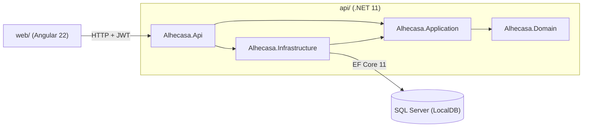

# Arquitectura

Este documento describe las capas del sistema, las decisiones tomadas y sus razones. Para instalar y ejecutar, consulta [README.md](README.md); para los endpoints, [api.md](api.md).

## Visión general



## Backend: Clean Architecture

Cada capa es un proyecto separado de la solución `api/Alhecasa.sln`. **Las dependencias solo apuntan hacia adentro**: `Api → Infrastructure → Application → Domain`. Domain no depende de ningún proyecto ni paquete.

### Alhecasa.Domain

Reglas de negocio y entidades, sin dependencias externas.

- `BaseEntity`: `Id` (Guid versión 7, generado en código), auditoría (`CreatedAt`, `UpdatedAt`) y borrado lógico (`IsDeleted`, `DeletedAt`).
- `User`: persona con acceso. Tiene rol, inmobiliaria opcional, estado activo y último acceso.
- `Agency`: inmobiliaria. Es el límite de aislamiento de datos (tenant).
- `AgencyKind` (`Company` \| `Individual`): una cuenta gratuita de particular es una `Agency` de tipo `Individual` con un solo usuario. Así sus propiedades y solicitudes quedan aisladas con el mismo filtro de tenant, sin un modelo paralelo (ver «Cuentas gratuitas de particulares»).
- `Property`: propiedad del inventario de una inmobiliaria (tenant). Sus invariantes (título, ciudad y estado obligatorios, precio mayor a cero, sin cuartos ni áreas negativos) se validan en el dominio. Por ahora lleva también precio, operación y estado; la estrategia (F0-07) los separa en una publicación (*Listing*).
- `PropertyImage`: imagen de una propiedad (tenant). Guarda solo metadatos (clave de almacenamiento, tipo, tamaño, orden); el archivo vive en el almacenamiento. `Property` controla la galería (`AddImage`, `RemoveImage`) y su tope de 10.
- `Inquiry`: solicitud de informes de una propiedad (tenant, agregado). Guarda los datos del prospecto, su pregunta, el estado (`New`, `InProgress`, `Closed`) y el título de la propiedad al momento de la solicitud. Controla su historial (`InquiryFollowUp`: respuesta o nota, con el nombre del autor al momento de escribirla) con tope de 200 registros; una respuesta pasa el estado a `InProgress`.
- `Plan` (catálogo de la plataforma, sin tenant) y `Subscription` (contratación de una cuenta, con tenant): la monetización; ver «Planes, suscripciones y destacados». `Property` lleva además `FeaturedUntil`.
- `PropertyType`, `OperationType`, `PropertyStatus`, `CurrencyCode`, `PlanKind`, `PlanAudience`, `BillingPeriod`: enumeraciones guardadas como texto.
- `UserRole`: `PlatformAdmin`, `AgencyAdmin`, `Supervisor`, `Seller` (vendedor), `Client`. El rol se guarda como texto, así que añadir valores no requirió migración.
- `DomainException`: violación de una regla del dominio.

**Invariante del dominio** (en `User`): `PlatformAdmin` no pertenece a ninguna inmobiliaria; `AgencyAdmin`, `Supervisor` y `Seller` (el personal de la inmobiliaria) siempre pertenecen a una; `Client` puede pertenecer a una o ser un anunciante particular (sin inmobiliaria).

Las entidades tienen constructores y setters privados: el estado solo cambia mediante métodos que validan la regla anterior.

### Alhecasa.Application

Casos de uso y contratos. Depende solo de Domain (y de FluentValidation).

- `Abstractions/`: interfaces que Infrastructure implementa (`IUserRepository`, `IAgencyRepository`, `IUnitOfWork`, `IPasswordHasher`, `IJwtTokenGenerator`) y la interfaz `ICurrentUser`, que Api implementa a partir del JWT.
- `Auth/`, `Users/`, `Agencies/`: DTOs (`record`), validadores y servicios de aplicación (`AuthService`, `UserService`, `AgencyService`).
- `Common/`: `PagedResult<T>` y las excepciones de aplicación (`NotFoundException`, `ConflictException`, `ForbiddenException`, `AuthenticationFailedException`).

Aquí viven las **reglas de autorización** (quién puede hacer qué con los usuarios), de modo que no dependen de HTTP ni de la base de datos.

### Alhecasa.Infrastructure

Detalles técnicos. Depende de Application.

- `Persistence/`: `AlhecasaDbContext` (implementa `IUnitOfWork`), `Configurations/` (una clase por entidad), `Repositories/`, `Migrations/` y `Seeding/`.
- `Identity/`: `Pbkdf2PasswordHasher`, `JwtTokenGenerator` y `JwtOptions`.
- `DependencyInjection.cs`: registra todo con `AddInfrastructure(configuration)`.

### Alhecasa.Api

Capa de entrega. Depende de Application e Infrastructure (esta última solo para registrar servicios en `Program.cs`).

- `Controllers/`: `AuthController`, `UsersController`, `AgenciesController`. Son delgados: delegan en los servicios de aplicación.
- `Middleware/GlobalExceptionHandler`: convierte excepciones en `ProblemDetails`.
- `Services/CurrentUser`: implementa `ICurrentUser` leyendo los claims.
- `OpenApi/`: esquema Bearer en el documento OpenAPI.
- `Program.cs`: composición (autenticación, autorización, CORS, límite de intentos, OpenAPI, salud).

## Decisiones de diseño

### Multiinmobiliaria con filtros globales de EF Core

Cada consulta a `Users` y `Agencies` pasa por un **filtro global** que aplica el borrado lógico y el aislamiento:

- `PlatformAdmin`: ve todo.
- Cualquier otro usuario: ve los registros de su inmobiliaria y, siempre, su propio usuario.
- Sin usuario autenticado: no ve nada.

Los valores del usuario actual vienen de `ICurrentUser`, que el `DbContext` consulta en cada consulta. Esto es **defensa en profundidad**: aun si un servicio olvidara filtrar, la base no devuelve datos de otra inmobiliaria. Un `AgencyAdmin` que pide un usuario de otra inmobiliaria recibe `404`, no `403`, para no revelar que existe.

`IgnoreQueryFilters()` se usa en tres lugares, todos justificados:
1. **Login:** todavía no hay usuario autenticado.
2. **Unicidad del correo:** debe ser global, no por inmobiliaria.
3. **Datos iniciales (seeding).**

Cualquier nuevo uso de `IgnoreQueryFilters()` debe revisarse con cuidado.

### Usuarios y contraseñas propios (sin ASP.NET Identity)

Se eligió una entidad `User` propia para mantener **Domain limpio**; ASP.NET Identity acoplaría Domain e Infrastructure a su modelo. Las contraseñas se guardan con **PBKDF2-HMAC-SHA512** (incluido en .NET): 210 000 iteraciones (recomendación de OWASP), sal aleatoria de 16 bytes por contraseña y comparación en tiempo constante. El formato almacenado es `PBKDF2$SHA512$iteraciones$sal$hash`, lo que permite subir las iteraciones en el futuro sin romper los hashes existentes.

Para no revelar qué correos están registrados, el login responde siempre con el mismo mensaje y, si el usuario no existe, ejecuta una verificación contra un hash ficticio para igualar el tiempo de respuesta.

### Cuentas gratuitas de particulares

Quien vende o renta por su cuenta se registra solo (`POST /api/auth/register`, pantalla `/registro`) y publica sin costo. **Decisión:** en lugar de crear un modelo paralelo para el particular, el registro crea un espacio propio —una `Agency` de tipo `Individual`, con el nombre de la persona— y un único usuario `AgencyAdmin` en él, todo en una transacción. Así propiedades, imágenes, galería, solicitudes de informes y aislamiento entre cuentas funcionan sin cambios, porque ya dependen de `AgencyId`.

Reglas propias de la cuenta gratuita:

- **Tope de propiedades**: el del plan gratuito (3 en el seed; `AccountLimits:IndividualMaxProperties` es el respaldo si no hay plan gratuito). Cuentan los borradores y no las eliminadas. Se revisa en `PropertyService.CreateAsync` y se responde `422` (`PlanLimitException`, con un mensaje en español listo para mostrar). Una cuenta puede subir el tope contratando un plan de pago (ver la sección siguiente).
- **No administra usuarios**: `UserService` le niega `/api/users` (`403`), y el menú y la ruta `/usuarios` se ocultan con `isIndividual` (que viaja en `CurrentUserDto` y en `GET /api/agencies`).
- **El servidor fija el rol y el espacio**; el cuerpo del registro no puede elegirlos, así que no hay escalada de privilegios.
- Alta limitada por IP (5 por hora) porque cada alta crea un espacio y un usuario.

Es el puente hacia el modelo `Membership` de la estrategia (particular = usuario estándar sin membresía): cuando exista, estos espacios `Individual` se migran a usuarios sin organización.

**Lo que esto no incluye todavía** (ver «Limitaciones»): verificación de correo y moderación de anuncios.

### Perfil público de la inmobiliaria

El administrador de una inmobiliaria configura su propia información desde la página de inicio («Mi inmobiliaria» → «Editar información»), y el público la ve en `/inmobiliarias/:id`, encima de sus publicaciones. `Agency` tiene los campos del perfil (descripción, sitio web, Facebook, Instagram, horario, calle, ciudad, estado, código postal y logotipo, además del nombre, correo y teléfono que ya tenía) y `AgencyProfileLimits` fija sus longitudes: la usan la validación y el esquema, para que no diverjan.

- **Quién:** solo el rol `AgencyAdmin` de una **inmobiliaria** (`/api/agencies/me`). `AgencyService` toma la inmobiliaria del usuario autenticado, nunca de la solicitud, así que no hay forma de editar otra; un particular (anónimo, sin página), el resto del personal, los clientes y el administrador de plataforma reciben `403`.
- **Qué se publica:** todo lo que se captura, **incluidos correo, teléfono y dirección de la oficina**; el formulario lo avisa. La dirección exacta de una *propiedad* sigue sin publicarse: esto es la oficina, que la inmobiliaria quiere que se conozca.
- **Enlaces seguros:** el sitio web y las redes deben ser `http://` o `https://` (se rechaza `javascript:`, `data:`, etc. al guardar, en la API y en el formulario), y la página los abre con `rel="noopener noreferrer nofollow"` en otra pestaña.
- **Visibilidad pública:** `GET /api/public/agencies/{id}` (y `/logo`) solo existe para inmobiliarias activas y no eliminadas; un particular, una inactiva o un id desconocido dan `404` sin distinguirse (`IAgencyRepository.GetPublicByIdAsync`, que ignora el aislamiento por inmobiliaria como el resto del catálogo público).
- **Logotipo:** JPEG, PNG o WebP de hasta 5 MB, validado por el contenido del archivo con las mismas reglas que las fotos de las propiedades (`PropertyImageRules.Validate`; un SVG, que puede llevar scripts, se rechaza). Se guarda con `IImageStorage` bajo una clave nueva en cada subida y el archivo anterior se borra. Se sirve por una dirección fija con `ETag` y `Cache-Control: public, no-cache` (la clave del archivo hace de versión): el navegador lo revalida y recibe `304` si no cambió.
- **Nombre:** cambiarlo cambia también cómo se publican sus propiedades (el catálogo lee el nombre de la inmobiliaria). La web actualiza el nombre de la sesión guardada (`AuthService.updateAgencyName`) para no pedir volver a ingresar.
### Catálogo de ubicaciones y páginas por zona (SEO)

Para que una búsqueda como «casas en venta en Polanco» pueda llevar a ALHECASA, las propiedades dejaron de depender de texto libre para su ciudad y colonia: hay un **catálogo de ubicaciones** y cada zona tiene **una dirección limpia**, con su propio título, descripción y mapa del sitio.

- **Tablas:** `GeoStates`, `GeoCities` y `GeoNeighborhoods` (entidades `GeoState`, `GeoCity`, `GeoNeighborhood`). Son del **catálogo de la plataforma**: no llevan inmobiliaria ni borrado lógico, y las comparten todas las inmobiliarias. `Property` conserva sus textos (`State`, `City`, `Neighborhood`) y gana `StateId`, `CityId` y `NeighborhoodId` (opcionales, `Restrict`). Los textos se conservan a propósito: la API pública y el resto de la web siguen leyéndolos sin cambios.
- **Población híbrida:** los 32 estados vienen precargados (`MexicanStates`, con abreviaturas y alias: `CDMX`/`DF` → Ciudad de México, `Edomex` → Estado de México). Las ciudades y colonias **se eligen de una lista y, si no existe la que se escribe, se crean al guardar la propiedad** (`LocationResolver`, que busca o crea y reutiliza lo que ya creó en la misma operación). No hay catálogo oficial (SEPOMEX): el catálogo crece con lo que capturan las inmobiliarias.
- **Nombres canónicos:** al guardar, la API **reemplaza** los textos capturados por los del catálogo, así «cdmx», «CDMX» y «Ciudad de México» terminan siendo el mismo estado, y «guadalajara» y «Guadalajara» la misma ciudad. Un nombre se ordena con `LocationNames.Tidy`: solo se pone en formato de título si el texto está todo en minúsculas o todo en mayúsculas y tiene más de 4 letras (así «CDMX» y «NL» se respetan). Un nombre sin letras ni números se rechaza con `400`.
- **Identificadores de la dirección web (slug):** `Slug.From` quita acentos, pasa a minúsculas y cambia lo que no sea letra o número por `-` (máximo 100). La ciudad es única en todo el catálogo por su slug; si dos estados tienen una ciudad con el mismo nombre, la segunda se llama `{ciudad}-{estado}` (`guadalajara-jalisco`). La colonia es única dentro de su ciudad. Esto vuelve a ser un detalle del catálogo: la web nunca arma slugs, los recibe de la API.
- **Propiedades que ya existían:** `DatabaseInitializer` precarga los estados y **liga** las propiedades sin ubicación al catálogo (crea las ciudades y colonias que haga falta) al terminar `MigrateAsync` (con `Database:MigrateOnStartup`) y en `SeedAsync`. Es idempotente: no toca lo ya ligado. Mientras no se ligue, una propiedad sigue funcionando; solo no aparece en las páginas por zona ni en el filtro `citySlug`.
- **Páginas por zona:** `/venta/:ciudad`, `/venta/:ciudad/:colonia`, `/renta/:ciudad` y `/renta/:ciudad/:colonia` (`ZoneListings`). La operación va en la dirección y el tipo de inmueble queda como filtro. Cada una pide `GET /api/public/zones/...` (conteos de venta y renta y colonias de la ciudad) y el catálogo público filtrado por `citySlug`/`neighborhoodSlug`. Una zona inexistente, o sin nada publicado, responde `404` y la página muestra un aviso; una zona **sin propiedades en esa operación** se pide no indexar (`noindex,follow`) y ofrece la otra operación. Los números salen de una sola consulta agrupada (`GetPublishedZoneCountsAsync`) con las mismas reglas de visibilidad que el catálogo público.
- **Etiquetas para buscadores:** `SeoService` (`shared/services`) fija título, descripción, dirección canónica, Open Graph, `robots` y datos estructurados (`BreadcrumbList` en las zonas). Las usan la portada, las zonas, el detalle público y las publicaciones de una inmobiliaria. Se limpian cuando **cambia la ruta** (no cuando solo cambian los parámetros: los filtros de la portada no las borran). La portada enlaza «Explora por zona» (`app-popular-zones`, con `GET /api/public/zones?limit=`) y el detalle de cada propiedad enlaza a su colonia y su ciudad: así los buscadores llegan a las zonas siguiendo enlaces normales.
- **Mapa del sitio y `robots.txt`:** `GET /api/public/sitemap.xml` (anónimo) devuelve el formato de sitemaps.org en UTF-8: la portada, la calculadora hipotecaria, las zonas con propiedades publicadas (cada operación con propiedades), cada publicación y cada inmobiliaria con nombre; **máximo 50,000 direcciones** (el tope del formato; un sitio mayor requeriría un índice de mapas). El dominio sale de `Seo:SiteUrl` (`Seo__SiteUrl` como variable de entorno; por omisión `http://localhost:4200`, que debe cambiarse en producción: la API lo valida al arrancar). `web/public/robots.txt` prohíbe las áreas privadas y trae la línea `Sitemap:` **comentada**, con un marcador para la dirección real: al desplegar hay que descomentarla y enviar el mapa a Google Search Console.
- **Limitación importante (sin SSR):** la web es una aplicación de una sola página sin renderizado en servidor, así que las etiquetas se ponen con JavaScript. Google las ejecuta; muchos rastreadores y las vistas previas al compartir en redes (WhatsApp, Facebook) **no**. El renderizado en servidor es el siguiente paso y es lo que cierra esa brecha; las direcciones limpias, el catálogo y el mapa del sitio ya quedan listos para él.
- **Salvedades:** dos usuarios que den de alta a la vez la misma ciudad nueva pueden chocar con el índice único (el segundo recibe un error y reintenta). «Ciudad de México» como ciudad no se trata como alias de la entidad (se captura como ciudad aparte). No se publica el catálogo completo, solo lo que tiene propiedades visibles.

### Planes, suscripciones y destacados

Así se monetiza el portal. El administrador de plataforma crea **planes** (`/planes`) y registra las **contrataciones** de cada cuenta (`/suscripciones`).

- **`Plan`** es del catálogo de la plataforma: no tiene `AgencyId` ni filtro de tenant (solo el borrado lógico). Tiene un `Kind` (`Listings`: tope de propiedades; `Featured`: paquete de anuncios destacados), una audiencia (`Individual`, `Company` o `Any`), un `Limit` (`null` = ilimitado), un `Period` (día, semana, mes o año), precio y moneda. El **plan gratuito** es el de precio 0: único, de publicaciones, para particulares, con tope y sin vencimiento; no se elimina ni se vuelve de pago.
- **`Subscription`** es una contratación de una cuenta (sí lleva filtro de tenant). **Guarda una copia** del tipo, el tope, el periodo y el nombre del plan, y el monto pagado: editar o eliminar un plan después no cambia lo ya contratado. Dura exactamente un periodo desde el registro. Una cuenta tiene como máximo una contratación vigente **por tipo**; contratar otra del mismo tipo cancela la anterior.
- **Dos caminos para contratar, una sola regla.** La cuenta compra con tarjeta (`CheckoutAsync`) o el administrador de plataforma registra un pago recibido fuera del sistema (`AssignAsync`). Ambos terminan en el mismo método privado (`SubscribeAsync`), así que reemplazo, vigencia y limpieza de destacados no se duplican.
- **Pasarela de pagos detrás de un puerto (decisión).** `IPaymentGateway` (Application) cobra y devuelve aprobado o rechazado (un rechazo no es una excepción: es un resultado). Hoy lo implementa `SimulatedPaymentGateway` (Infrastructure), que decide según el número de tarjeta. Integrar la real es cambiar una línea en `AddInfrastructure`: servicios, endpoints y pantallas no cambian. Un rechazo se convierte en `PaymentDeclinedException` → `402`, y no deja nada a medias porque el cobro ocurre **antes** de guardar la contratación.
- **El servidor cobra el precio del plan**, nunca un monto del cliente. La tarjeta no se guarda ni se registra (`ToString` de los objetos que la llevan la oculta; los errores de validación no repiten lo capturado). Con la pasarela real lo ideal es tokenizar en el navegador para que la tarjeta nunca pase por el servidor.
- **Protección contra desplegar la simulación:** como aprueba sin cobrar, `Program.cs` se niega a arrancar fuera de Desarrollo salvo con `Payments:AllowSimulated=true`. Al integrar la pasarela real, esa comprobación se retira.
- **El tope de publicaciones** lo resuelve `EntitlementService`: una contratación vigente manda; si no hay y la cuenta es de un particular, el plan gratuito; si no hay y es una **inmobiliaria**, no hay tope (así siguen las que existían antes de los planes, hasta que se les asigne uno). Al vencer una contratación la cuenta vuelve a esa base. Cuentan las propiedades existentes, borradores incluidos y sin las eliminadas.
- **Destacados:** `Property.FeaturedUntil` guarda hasta cuándo está destacada, que es el fin del paquete que la destacó. Una propiedad está destacada mientras `FeaturedUntil` sea posterior a «ahora» (por eso no hay un trabajo que vencerlos: el reloj lo resuelve). El paquete limita **cuántas están destacadas a la vez** (`Limit`), no cuántas veces se destaca. Solo se destaca una propiedad `Published`; al dejar de estarlo pierde el destacado. Cambiar o cancelar el paquete **quita el destacado de todas** las propiedades de la cuenta (el paquete nuevo puede tener otra capacidad): hay que elegirlas de nuevo.
- **Orden público:** con el orden por defecto (`Recent`) los destacados van primero (`FeaturedUntil > now` descendente, luego la antigüedad y el id). Con otro orden no se anteponen, pero `isFeatured` siempre viaja para mostrar la etiqueta.
- **Hora:** todo usa `TimeProvider` (en las pruebas, un reloj que se adelanta), nunca `DateTime.UtcNow`.
- **Seed:** `DatabaseInitializer` crea los planes solo si no hay ninguno: el gratuito y unos planes de ejemplo (inmobiliaria 100/200/300/500, premium ilimitado y varios paquetes de destacados). **Los precios son ilustrativos**: se editan en `/planes`.
- **Lo que falta:** la pasarela real, facturación, renovación automática, avisos de vencimiento y reembolsos o prorrateo al cambiar de plan (se reemplaza sin devolver nada).

### JWT

- Algoritmo HMAC-SHA256. Claims: `sub`, `email`, `name`, `role`, `agency_id`, `jti` e `iat`.
- Vigencia de 60 minutos, con tolerancia de reloj de 30 segundos.
- La clave de firma no está en el código ni en `appsettings.json`: se obtiene de user-secrets o variables de entorno, y se valida al iniciar (mínimo 32 caracteres).
- Se desactiva el mapeo automático de claims (`MapInboundClaims = false`) para usar nombres cortos y estables.
- **Revalidación en cada petición:** los permisos se toman de los claims del token, pero tras verificar la firma, `JwtBearerEvents.OnTokenValidated` (`Api/Authentication/SessionRevalidation.cs`) consulta la base mediante `ISessionValidator` y rechaza con `401` si el usuario ya no existe, está desactivado o eliminado, cambió de rol o de inmobiliaria, o su inmobiliaria fue eliminada o desactivada. El costo es una consulta ligera por petición autenticada (proyección de tres columnas con `IgnoreQueryFilters`, porque en ese momento el usuario de la solicitud todavía no está establecido). A cambio, el acceso se revoca en la siguiente petición y no al vencer el token.

### Seguridad por defecto

- **Política de autorización por defecto:** todo endpoint exige autenticación, salvo los marcados con `[AllowAnonymous]` (login, `/health` y el catálogo público `/api/public/properties`).
- **Catálogo público:** es el único lugar donde se lee el inventario sin el filtro por inmobiliaria (`IgnoreQueryFilters`), porque el visitante no tiene una. La visibilidad se define de forma explícita en `PropertyRepository.GetPublishedPagedAsync` (publicada, no eliminada, inmobiliaria activa y no eliminada), el contrato `PublicPropertyDto` omite calle y código postal y solo trae la ubicación redondeada a unos 110 m (`PublicPropertyService.ApproximateCoordinate`), y el endpoint tiene límite de 120 solicitudes por minuto por IP.
- **Filtros avanzados (backend):** el catálogo público y la lista del personal comparten el contrato `IPropertyCriteria` (tipo, operación, precio con moneda, recámaras, baños, estacionamientos, m², mascotas, amueblada, amenidades y orden), y `PropertyRepository.ApplyCriteria` los traduce a una sola consulta, de modo que no pueden diverger. La galería de la inmobiliaria también los acepta. `PropertyCriteriaRules.Validate` rechaza valores absurdos con `400` (un rango invertido, un precio sin moneda, una amenidad desconocida). Decisiones: (1) **el precio no se convierte entre monedas**: se filtra dentro de la moneda elegida y el orden por precio compara números crudos; convertir exige un tipo de cambio que hoy no existe. (2) `Amenity` es un enum `[Flags]` guardado como entero (una columna, filtro «tiene todas» con `(Amenities & mask) == mask`) y es la única excepción a «enums como texto» en la base; la API siempre lo expone como lista de nombres, y agregar una amenidad es agregar un bit (máx. 31). (3) La superficie filtra por `ConstructionArea ?? LandArea`, para que un terreno también aparezca. (4) Los desempates del orden son `CreatedAt` e `Id`, así la paginación es estable. (5) Un campo sin capturar (`null`) no cumple un mínimo mayor que 0. Las propiedades sembradas antes de esta función se completan con `DatabaseInitializer.EnsureAdvancedDetailsAsync` solo si no tenían ningún dato avanzado capturado, para no pisar lo que el personal haya editado.
- **Roles en los controladores:** `UsersController` y `AgenciesController` exigen `PlatformAdmin` o `AgencyAdmin`.
- **Límite de intentos:** 10 por minuto por IP en el login.
- **Imágenes de propiedades (1 a 10, hasta 5 MB cada una):**
  - *Almacenamiento:* la abstracción `IImageStorage` (Application) se implementa con `LocalImageStorage`, que guarda archivos en `App_Data/images` (opción `Storage:ImagesPath`, fuera de git y fuera de la raíz web, así que nada se sirve directo del disco). Solo acepta las claves que genera el sistema (32 hexadecimales y extensión), de modo que una clave manipulada no puede salir de la carpeta. Para producción se cambia por otra implementación (por ejemplo almacenamiento de objetos) sin tocar el resto.
  - *Validación:* el formato (JPEG, PNG o WebP) se decide por los primeros bytes del archivo, no por el nombre ni por el `Content-Type` declarado. Se valida todo antes de guardar nada y, si algo falla antes de confirmar en la base, se borran los archivos recién guardados.
  - *Galería atómica:* `POST /api/properties/{id}/images` agrega y quita en una sola operación, para poder cambiar una foto con la galería llena.
  - *Regla de publicación:* una propiedad `Published` necesita al menos una imagen. Por eso una propiedad nueva se crea como borrador y se publica después de subir imágenes; el formulario Angular lo encadena (crear, subir, publicar) y, si un paso falla, conserva lo ya guardado para reintentar.
  - *Entrega pública:* `GET /api/images/{id}` no pide token (las etiquetas `` no lo envían). Es un **enlace secreto**: el guid no se puede adivinar, pero quien lo conoce ve la imagen aunque la propiedad sea un borrador. Es una decisión consciente; si se necesitara privacidad estricta de borradores, habría que servir con URL firmadas o con token. Tiene límite de 600 solicitudes por minuto por IP y caché de un año (`immutable`).
  - *Pendiente:* no se redimensionan las imágenes ni se les quitan los metadatos EXIF (por ejemplo la ubicación GPS de la foto); no hay reordenamiento (la primera es la portada).
- **CORS:** lista explícita de orígenes desde configuración; solo los encabezados y métodos necesarios.
- **Cabeceras:** `X-Content-Type-Options`, `X-Frame-Options` y `Referrer-Policy`. En producción se activan HSTS y la redirección a HTTPS.
- **Errores:** `ProblemDetails` (RFC 9457). El detalle de un error interno (500) nunca se envía al cliente; solo se registra.
- **Búsqueda:** los caracteres comodín de `LIKE` se escapan para que el texto del usuario no altere la consulta.
- **Validación:** FluentValidation en cada solicitud de entrada; paginación acotada (máximo 100 por página).

### Persistencia

- **Borrado lógico** en todas las entidades. El correo es único solo entre usuarios no eliminados (índice filtrado `[IsDeleted] = 0`), de modo que se puede reutilizar tras un borrado.
- **Identificadores Guid v7:** únicos y ordenables por tiempo, y se generan en código.
- **Rol como texto** (`nvarchar(30)`): la base es legible y estable ante cambios del orden del enum.
- **Fechas** como `datetimeoffset`, con un `TimeProvider` inyectable (facilita las pruebas).
- **Auditoría** automática en `SaveChanges` (`CreatedAt`, `UpdatedAt`).
- **Resiliencia:** reintentos ante fallos transitorios de SQL Server.
- **Migraciones** en `Infrastructure/Persistence/Migrations`, aplicadas con `dotnet ef database update`. En Desarrollo también se pueden aplicar al arrancar.

### Sin MediatR ni mapeadores

Se evitó MediatR 15 porque requiere licencia comercial, y para este alcance bastan servicios de aplicación por caso de uso. El mapeo entre entidades y DTOs es manual: es explícito y no añade dependencias.

### Convenciones

- Nullable habilitado y advertencias como errores en toda la solución (`Directory.Build.props`).
- Versiones de paquetes centralizadas en `Directory.Packages.props`.
- Se desactivan las reglas CA1848 y CA1873 (obligan a usar `LoggerMessage`), por ser excesivas para este alcance.
- Código en inglés; interfaz de usuario en español.

## Frontend: Angular por funcionalidades

Angular 22 con **componentes standalone**, sin zone.js, con detección de cambios `OnPush` y estado con signals.

```
web/src/app/
├── core/                  Autenticación (servicio, interceptor, guards) y modelos globales
├── shared/                Componentes reutilizables (modal, paginador, toast, alerta de error) y utilidades
├── layout/                Marco de la aplicación con el menú lateral
└── features/              Una carpeta por funcionalidad, con carga diferida (lazy)
    ├── auth/login/
    ├── home/
    ├── landing/           Portada pública con el catálogo de propiedades publicadas
    ├── properties/        Inventario de propiedades (lista, formulario, detalle)
    └── users/             Lista, modal de alta y edición, modal de detalle, servicios y rutas
```

### Decisiones del frontend

- **Estilos:** Tailwind CSS 4 con DaisyUI 5, e iconos de Font Awesome Free. No se usan otras librerías de UI. La paleta, las fuentes (Manrope e Inter, servidas desde la propia app) y el logo salen de la [identidad visual](identidad-visual.md), implementada como tema `alhecasa` en `styles.css`.
- **Rutas con carga diferida** y guards: `authGuard` (exige sesión), `guestGuard` (solo visitantes) y `roleGuard` (exige rol). El menú muestra un ítem solo si el usuario puede abrir esa ruta.
- **Portada pública en `/`:** la ruta usa `canMatch: [guestMatch]`, así que solo coincide sin sesión; con sesión el enrutador sigue a la ruta siguiente y `/` abre el área de trabajo (`/inicio`). Lista las propiedades publicadas con `GET /api/public/properties` (sin token) y enlaza al login.
- **Mapa en el detalle público:** `app-location-map` (`shared/components/location-map`) usa Leaflet con mosaicos de OpenStreetMap y dibuja un **círculo de 250 m**, no un marcador, porque el producto no publica la dirección exacta: el personal captura la ubicación exacta (campo «latitud, longitud» del formulario, copiada de Google Maps; no hay geocodificación), pero el visitante solo recibe coordenadas redondeadas, y el círculo es mayor que el redondeo. Sin ubicación, el detalle no muestra la sección. Leaflet se carga de forma diferida (`LEAFLET_LOADER`, un `InjectionToken` que las pruebas sustituyen), así que solo lo descarga quien abre un detalle con mapa; si falla la carga se avisa en el recuadro. La rueda del ratón no hace zoom para no atrapar el scroll. **Uso de OpenStreetMap:** los mosaicos públicos son gratuitos pero con política de uso razonable y atribución obligatoria (ya se muestra); para un tráfico alto en producción hay que contratar un proveedor de mosaicos o alojar los propios y cambiar `TILE_URL`. Las propiedades de ejemplo reciben sus coordenadas al iniciar (`EnsureSampleCoordinatesAsync`, solo si no tienen).
- **Galería de la inmobiliaria (`/galeria`):** opción del menú para `AgencyAdmin`, `Supervisor` y `Seller` (no para el administrador de plataforma, que no pertenece a una inmobiliaria). Muestra las propiedades publicadas de la inmobiliaria del usuario con la misma tarjeta que la portada pública (`app-public-property-card`, compartida: así no pueden diverger) y datos que vienen de `GET /api/properties/gallery`, que devuelve el `PublicPropertyDto` y reutiliza las reglas de visibilidad pública (`PropertyRepository.GetPublishedPagedAsync` con el filtro opcional `agencyId`, que solo usa ese endpoint y no el catálogo público). Es de solo lectura; las tarjetas enlazan al detalle público. Los corazones funcionan igual que afuera (`localStorage`).
- **Filtros avanzados (portada y lista del personal):** el panel es un componente compartido, `app-advanced-filters` (`shared/components/advanced-filters`), que recibe un `AdvancedCriteriaForm` tipado; `property-criteria.ts` concentra la normalización, el conteo de filtros activos y la traducción a parámetros de la API y de la URL. En la portada, **los filtros viven en la URL** (`?operacion=…&tipo=…&ubicacion=…&favoritas=…&precioMin=…&precioMax=…&moneda=…&recamaras=…&banos=…&estacionamientos=…&m2Min=…&m2Max=…&mascotas=…&amueblada=…&amenidades=Pool,Gym&orden=…&pagina=…`), con nombres en español porque el visitante los ve: una búsqueda se puede compartir, recargar o recuperar con «Atrás». La pantalla lee la URL al entrar y ante cada navegación externa, y al cambiar un filtro la escribe con `replaceUrl` (no llena el historial con cada tecla); recuerda la última URL que escribió ella misma para no recargar por su propio cambio. Un valor inválido en la URL se ignora. El botón «Más filtros» muestra cuántos criterios hay activos y el título de la lista describe el orden. La lista del personal (`/propiedades`) tiene los selectores de estado, tipo y operación (se aplican al elegirlos) y el mismo panel «Más filtros» con «Aplicar filtros» y «Limpiar filtros»; sus filtros no van a la URL.
- **Solicitudes de informes:** en el detalle público (`/publicaciones/:id`) el botón «Pedir informes» abre un modal (`app-inquiry-form-modal`) con nombre, teléfono, correo y pregunta, con las mismas reglas que la API; si hay sesión, sugiere nombre y correo. Envía `POST /api/public/properties/{id}/inquiries`, que no devuelve datos (`201` vacío) y tiene su propio límite por IP porque es una escritura anónima. El personal (`AgencyAdmin`, `Supervisor`, `Seller`) las atiende en «Solicitudes de informes» (`/solicitudes`): lista con filtro por estado y búsqueda; al abrir una fila ve los datos del prospecto (con enlaces `tel:` y `mailto:`), su pregunta, el historial y un formulario para registrar una respuesta o una nota y cambiar el estado. **No se envía correo desde el sistema** (no hay infraestructura de correo todavía): el historial es constancia de lo que el personal contestó por su cuenta; el modal ofrece un enlace `mailto:` ya redactado. La solicitud pertenece a la inmobiliaria de la propiedad (filtro global de tenant), así que el aislamiento entre inmobiliarias es el mismo que el de las propiedades; el administrador de plataforma no las ve.
- **Cuenta gratuita (`/registro`):** formulario de nombre, apellidos, correo y contraseña (con las mismas reglas que la API y confirmación). Al terminar, la API ya devuelve la sesión y se abre `/propiedades` para publicar la primera propiedad. El registro se ofrece en la portada («Publica gratis» en la cabecera y en la presentación), en el detalle público y en el login. Con `isIndividual`, el menú oculta «Usuarios» y la barra muestra «Cuenta gratuita» en lugar del rol; la ruta `/usuarios` se protege con `companyGuard`. El `422` del tope de propiedades se muestra con el mensaje de la API (`resolveApiError`).
- **«Me gusta» en publicaciones:** `LikesService` (`core/likes`) guarda en `localStorage` (clave `alhecasa.likes`) la lista de identificadores de las publicaciones que le gustan al visitante, y `app-like-button` es el corazón que se usa en la lista y en el detalle. Es **solo del navegador**, sin backend: funciona igual con o sin sesión y cerrar sesión no lo borra (la clave es independiente de la de sesión), pero no viaja entre dispositivos ni navegadores, y se pierde si el visitante borra los datos del sitio. Guarda como máximo 100 (descarta los más antiguos), el mismo tope de ids que acepta el catálogo público por solicitud, ignora datos dañados y, si el navegador no deja escribir, el corazón sigue marcado solo mientras la pestaña esté abierta. Se sincroniza entre pestañas con el evento `storage`. El filtro **«Mis favoritas»** de la portada pide a la API solo esas publicaciones con `GET /api/public/properties?ids=…` (las mismas reglas de visibilidad: una favorita que ya no está publicada deja de aparecer); sin ninguna favorita no se llama a la API, porque una lista vacía de ids significa «sin filtro». Si más adelante se quisiera conservar entre dispositivos, habría que moverlo al servidor asociado a la cuenta.
- **Calculadora hipotecaria:** funciona **solo en el navegador**, sin API ni base de datos. El cálculo vive en funciones puras (`shared/utils/mortgage.ts`: sistema francés de cuota fija, tabla de amortización, gastos iniciales y la operación inversa «cuánto me alcanza»), que se prueban sin Angular; el componente `app-mortgage-calculator` (`shared/components/mortgage-calculator`) solo captura los datos, los valida y muestra el resultado, y se usa en dos lugares: en el detalle público (`/publicaciones/:id`), **solo en publicaciones en venta**, precargado con el precio y la moneda de la publicación (sin selector de moneda), y como página pública `/calculadora-hipotecaria`, enlazada desde la cabecera de la portada. La página lee `?precio=&moneda=` (el detalle enlaza con esos datos) e ignora lo que no reconoce (precio no numérico, cero o negativo; moneda distinta de MXN o USD). Muestra mensualidad, monto del crédito, total pagado, intereses, gastos al iniciar (enganche, comisión por apertura, avalúo y gastos de escrituración, con valores de ejemplo editables), seguro mensual opcional, una barra de capital contra intereses y la tabla de amortización (por año o mes a mes; se genera solo al abrirla). Con un resultado que no se puede calcular (por ejemplo, enganche negativo o mayor al precio) muestra el mensaje de error en lugar de cifras. Límites: tasa de 0 a 100 % anual y plazo de 1 a 40 años; con tasa 0 la mensualidad es capital entre meses, y la última fila de la tabla absorbe el redondeo para terminar en cero. No guarda ni comparte simulaciones.
- **Aviso de privacidad y aviso de la calculadora:** `app-privacy-notice` (`shared/components/privacy-notice`) es la leyenda «Al <acción>, tus datos se tratarán conforme al aviso de privacidad» con un enlace que abre `app-privacy-notice-modal`, el aviso completo en una ventana modal (qué datos se recaban, para qué, con quién se comparten y derechos ARCO). Solo informa: no pide aceptar nada ni se guarda constancia. Va en los formularios donde se capturan datos personales o de una propiedad: solicitud de informes, registro, alta y edición de propiedades y alta y edición de usuarios. Su enlace es un `<button type="button">` para no enviar el formulario que lo contiene, y `app-modal` detiene la propagación de su `submit` y da a cada título un id propio, porque el aviso se abre encima de otros modales. `app-mortgage-disclaimer` es el recuadro de la calculadora hipotecaria que dice que los cálculos son solo un parámetro, no una promesa, y que hay que consultar al banco o institución de financiamiento. **El texto del aviso es de referencia: antes de producción debe revisarlo quien asesore legalmente a la empresa** (el responsable, el domicilio y el medio para ejercer los derechos ARCO aún no están definidos). El pago de planes todavía no lleva la leyenda.
- **Perfil de la inmobiliaria (web):** `app-agency-profile-card` (`features/agency-profile`) es la tarjeta «Mi inmobiliaria» de la página de inicio, solo para el `AgencyAdmin` de una inmobiliaria; abre `app-agency-profile-modal`, con los datos, enlaces, dirección y logotipo (vista previa, quitar, reemplazar). Guarda primero los datos (`PUT /api/agencies/me`) y después el logotipo si cambió, en dos solicitudes: si falla la segunda, los datos ya quedaron guardados y el modal muestra el error. Los campos opcionales vacíos viajan como `null`, y los enlaces se validan como en la API. La página pública (`app-agency-header` en `/inmobiliarias/:id`) pide la información aparte de las publicaciones: si no carga (o no existe), las publicaciones se muestran igual, con el nombre que traen.
- **Interceptor HTTP:** añade el token solo a peticiones hacia la API propia (nunca a terceros) y cierra la sesión ante un 401, excepto en el login. Cuando el usuario pulsa «Cerrar sesión» vuelve a la portada pública (`/`); cuando la sesión vence (401) va al login, con `returnUrl` para regresar a la pantalla en la que estaba.
- **Redirección segura tras el login:** solo se aceptan rutas internas (`/ruta`); se rechaza `//host` para evitar redirecciones abiertas.
- **Catálogo de usuarios:** lista paginada de 10 con búsqueda con debounce de 300 ms. El mismo modal sirve para alta y edición; un clic en la fila abre un modal de detalle de solo lectura. El éxito se muestra en un toast de 3 segundos y los errores en una alerta a todo el ancho con una X.
- **Modales** con `<dialog>` nativo: el navegador aporta el bloqueo de foco, la tecla Esc y el fondo inerte.
- **Mensajes de error en español:** `resolveApiError` traduce el código HTTP; en 400 añade los detalles de validación del servidor.
- **Entornos:** `environment.development.ts` apunta a `http://localhost:5156/api`; el de producción usa `/api` (la API detrás del mismo dominio).
- **Sesión en `localStorage`:** el token se guarda en el almacenamiento local, de modo que persiste entre pestañas y reinicios. Ten en cuenta el compromiso: es cómodo, pero un ataque XSS podría leerlo. Mitigaciones actuales: vigencia corta (60 minutos) y plantillas de Angular que sanean por defecto (no se inserta HTML dinámico). Si el riesgo no es aceptable, la alternativa es una cookie `HttpOnly` con protección CSRF.

## Permisos

| Operación | `PlatformAdmin` | `AgencyAdmin` | `Supervisor`, `Seller`, `Client` |
|---|---|---|---|
| Ver y listar usuarios | Todos | Solo los de su inmobiliaria | Sin acceso |
| Crear usuario | Cualquier rol e inmobiliaria | `AgencyAdmin`, `Supervisor` o `Seller`, siempre en su inmobiliaria. No puede crear `Client` ni convertir a alguien en `Client` | Sin acceso |
| Editar usuario | Cualquiera | Solo de su inmobiliaria, nunca un `PlatformAdmin` | Sin acceso |
| Eliminar usuario | Cualquiera (menos a sí mismo) | Solo de su inmobiliaria (menos a sí mismo) | Sin acceso |
| Ver inmobiliarias | Todas | Solo la suya | Sin acceso |
| Ver, crear, editar y eliminar propiedades | Todas (al crear debe elegir inmobiliaria) | Solo las de su inmobiliaria | `Supervisor` y `Seller`: solo las de su inmobiliaria. `Client`: sin acceso |
| Ver y atender solicitudes de informes | Sin acceso | Solo las de su inmobiliaria | `Supervisor` y `Seller`: solo las de su inmobiliaria. `Client`: sin acceso |
| Comprar un plan para su cuenta (`GET /api/billing/plans`, `POST /api/billing/checkout`) | Sin acceso | Sí | Sin acceso (`Supervisor`, `Seller` y `Client`) |
| Crear planes y registrar o cancelar contrataciones | Sí (`/api/plans`, `/api/billing/accounts/...`) | Sin acceso | Sin acceso |
| Ver el plan y el uso de la propia cuenta | Sin acceso (no tiene cuenta) | Sí (`GET /api/billing/me`) | `Supervisor` y `Seller`: sí. `Client`: sin acceso |
| Destacar o quitar el destacado de una propiedad | Sí, con el paquete de la cuenta de la propiedad | Solo las de su inmobiliaria | `Supervisor` y `Seller`: solo las de su inmobiliaria. `Client`: sin acceso |
| Registrarse y publicar gratis | Sin acceso (no aplica) | Público, sin sesión: `POST /api/auth/register` crea un espacio `Individual` con un usuario `AgencyAdmin` (tope de propiedades; no administra usuarios) | Público, sin sesión (igual) |

Nadie puede cambiar su propio rol, desactivarse ni eliminarse.

**Supervisor y Seller:** el administrador de la inmobiliaria los da de alta como empleados. Hoy gestionan por completo las propiedades de su inmobiliaria (un `Seller` también puede editar y eliminar las de sus compañeros: aún no existe la noción de "propiedad asignada a un vendedor"); sus permisos sobre leads y supervisión del equipo se definirán cuando existan esos módulos. Dejar la administración de usuarios solo en `AgencyAdmin` es una decisión deliberada; si un `Supervisor` debe poder dar de alta vendedores, hay que ampliar `RoleNames.UserManagers` y las reglas de `UserService` (que hoy permitirían a un supervisor crear otro `AgencyAdmin`).

## Pruebas del backend

Dos proyectos en `api/tests`, con xUnit v3 sobre Microsoft.Testing.Platform (activado en `global.json`, porque el SDK de .NET 10 en adelante ya no admite VSTest con ese corredor):

| Proyecto | Qué prueba | Cómo |
|---|---|---|
| `Alhecasa.UnitTests` | Invariantes de `User`, reglas de permisos de `UserService`, `AuthService`, `SessionValidator` y `Pbkdf2PasswordHasher` | Dobles escritos a mano (sin librería de mocks); el hasher real se prueba aparte |
| `Alhecasa.IntegrationTests` | La API completa con `WebApplicationFactory`: login, aislamiento por inmobiliaria, permisos `401`/`403`/`404`, errores `ProblemDetails`, límite de intentos de login y revalidación del token | Base SQLite en memoria, una por clase de pruebas |

Decisiones y salvedades:

- **SQLite y no SQL Server** en las pruebas de integración: no dependen de LocalDB ni de una instancia instalada. El esquema se crea desde el modelo de EF (`EnsureCreated`), por lo que **las migraciones de SQL Server no se ejercitan** aquí. La Fase 0 (F0-03) añade pruebas de contrato contra más de un motor. SQLite no sabe ordenar por `DateTimeOffset`, así que un personalizador de modelo exclusivo de las pruebas (`SqliteModelCustomizer`) lo convierte a binario; el modelo de producción no se toca.
- Los tokens de prueba se emiten con el generador real (`IJwtTokenGenerator`) sin pasar por el login, que tiene límite de intentos por IP, y el hash de contraseña (PBKDF2, lento a propósito) se calcula una sola vez.
- Las pruebas de F0-02 se verificaron desactivando la revalidación: fallan las que corresponden (rol, inmobiliaria, desactivación, claims inválidos).

## Limitaciones y pendientes

Lo que este alcance **no** incluye, para que nadie lo dé por hecho:

- **Pruebas del backend:** existen, pero no cubren todo. Faltan pruebas de contrato de repositorios sobre SQL Server real y de las migraciones (las pruebas de integración usan SQLite; ver [Pruebas del backend](#pruebas-del-backend)).
- **Recuperar y cambiar contraseña**, verificación de correo y bloqueo de cuenta tras intentos fallidos. Solo existe el límite de intentos por IP.
- **Control de concurrencia optimista** (dos ediciones simultáneas del mismo usuario: gana la última).
- **Cierre de sesión en el servidor:** el acceso se revoca cuando la cuenta cambia, pero no hay lista de tokens revocados: un token de una cuenta sana sigue siendo válido hasta que vence, aunque el usuario "cierre sesión" en el navegador. Requiere un identificador de sesión o una lista de `jti` revocados.
- **Registro de inmobiliarias:** hoy las inmobiliarias solo se crean con el seeding o directamente en la base (`GET /api/agencies` es de solo lectura). El registro público existe solo para particulares (cuenta gratuita).
- **Cuenta gratuita sin verificación ni moderación:** el correo no se verifica (no hay infraestructura de correo) y los anuncios se publican de inmediato, sin revisión. El `409` del registro revela que un correo ya tiene cuenta. Un particular se publica como «Particular»: el catálogo público nunca muestra su nombre real (`PublicPropertyService.IndividualPublisherName`); el nombre queda solo en su cuenta.
- **Entidades `Client` y `Listing`:** forman parte del propósito del proyecto pero aún no están implementadas. `Plan` ya existe (ver «Planes, suscripciones y destacados»).
- **Pasarela de pagos real:** la compra con tarjeta funciona, pero contra una simulación que no mueve dinero (y que por eso exige `Payments:AllowSimulated=true` fuera de Desarrollo). Tampoco hay facturación ni renovación automática, y los precios del seed son ilustrativos. Una inmobiliaria sin plan contratado sigue sin tope hasta que el administrador le asigne uno.
- **Calculadora hipotecaria informativa:** es una estimación, no una oferta. No calcula el CAT, no usa tasas reales de ningún banco (la tasa, el plazo y los gastos que trae son ejemplos editables), no contempla tasas variables ni pagos extra, no incluye impuestos ni seguros obligatorios más allá del seguro mensual opcional que capture el usuario, y no persiste nada (se pierde al recargar). La pantalla lo avisa con `app-mortgage-disclaimer`: los cálculos son solo un parámetro para darse una idea y no una promesa, y para conocer las condiciones reales hay que consultar al banco o institución de financiamiento.
- **Perfil de la inmobiliaria:** no hay moderación del contenido que el administrador captura (descripción, enlaces, logotipo), no se verifica que el sitio o las redes existan ni que sean de la inmobiliaria, y no hay recorte ni redimensionado del logotipo (se muestra tal cual, ajustado al recuadro). Los datos y el logotipo se guardan en dos solicitudes, sin transacción entre ambas. Un particular no tiene página ni perfil. El horario es texto libre, sin días ni horas estructurados.
- **Despliegue:** no hay Dockerfile ni pipeline de CI.

## Evolución prevista

Lo descrito en este documento es el **estado actual**. La dirección futura (roadmap por fases, modelo de organizaciones, publicación multiportal y backlog de la Fase 0) está en [estrategia.md](estrategia.md). Estas son las decisiones de arquitectura que ya se adoptaron para el siguiente paso:

- **Persistencia intercambiable.** Hoy `Alhecasa.Infrastructure` mezcla la parte agnóstica de EF Core (DbContext, configuraciones y repositorios) con lo específico de SQL Server (`UseSqlServer`, las migraciones y el filtro del índice `[IsDeleted] = 0` en `UserConfiguration.cs`). El objetivo es separar un proyecto de proveedor, `Alhecasa.Infrastructure.SqlServer`, elegido con `Database:Provider`, de modo que cambiar de motor no toque Domain ni Application. Application ya depende solo de interfaces, así que el trabajo se concentra en Infrastructure.
- **Todas las dependencias externas detrás de puertos** definidos en Application: archivos, correo, pagos, mapas, búsqueda y portales inmobiliarios.
- **Búsqueda detrás de `IListingSearch`**, con una primera implementación en SQL y sustituible por OpenSearch cuando el volumen lo justifique.
- **Modelo de usuarios:** pasar de `User` con un solo `AgencyId` y un solo rol a `User` + `Organization` + `Membership` (roles por organización), y separar `Property` de `Listing`.
- **Monolito modular** con los módulos Accounts, Catalog, Search, Leads, Billing e Integrations.

Las limitaciones actuales de la sección anterior se abordan en la Fase 0 de [estrategia.md](estrategia.md#9-backlog-de-la-fase-0).
