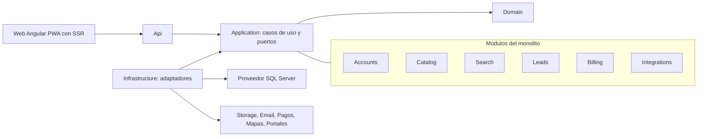

# Estrategia unificada de desarrollo

Este documento unifica tres fuentes en una sola estrategia:

1. **PDF** `ALHECASA Plataforma de bienes raíces funcionalidades a implementar.pdf`: catálogo de funcionalidades y hoja de ruta en 3 fases.
2. **PPTX** `ALHECASA_Analisis_Competitivo_y_Alcance_Funcional 1.pptx`: benchmark, perfiles, arquitectura sugerida, modelo de dominio, MVP, métricas y roadmap en 4 fases.
3. **Análisis de EasyBroker** (sitio, centro de ayuda y documentación de su API para partners): publicación multiportal, leads centralizados y otros módulos.

Es un documento vivo. Describe **qué se construye, en qué orden y por qué**. Para el estado actual del código, consulta [arquitectura.md](arquitectura.md); para instalar y ejecutar, [README.md](README.md).

## 1. Decisiones tomadas

| Tema | Decisión |
|---|---|
| Posicionamiento | **Híbrido:** marketplace propio primero. En la Fase 2 se capta oferta importando inventario (CSV/XML y alta como partner de integración de EasyBroker). En la Fase 3 se publica hacia portales externos con un clic. |
| Base de datos | Se **mantiene SQL Server**, con una capa de persistencia intercambiable por otro motor sin tocar Domain ni Application (ver sección 4). |
| Entidades núcleo | Se conservan las del alcance original (Usuarios, Clientes, Planes, Propiedades, Publicaciones) y se refinan con el modelo del PPTX (sección 3). |

## 2. Principios rectores

1. **Liquidez antes que funcionalidades.** Una zona piloto, anuncios vigentes y respuesta rápida. El éxito se mide por conectar oferta vigente con demanda real, no por volumen de anuncios ni de visitas.
2. **La confianza es producto.** Verificación, moderación, reportes y transparencia sobre qué se verificó. Nunca se afirma que una propiedad está legalmente validada sin evidencia.
3. **Freemium.** No cobrar pronto al particular. No fijar precios definitivos sin entrevistas y pruebas de disposición a pagar.
4. **Monolito modular con puertos y adaptadores.** Toda dependencia externa (base de datos, archivos, correo, pagos, mapas, portales) va detrás de una interfaz definida en Application. Se distribuye solo cuando el volumen lo justifique.
5. **Validar antes de codificar.** Entrevistar a 10 propietarios, 10 agentes y 5 inmobiliarias pequeñas, y elegir la zona piloto. Es un carril sin código que corre en paralelo al desarrollo.
6. **Honestidad de alcance.** Cada fase declara lo que deja fuera.

**North Star:** contactos calificados por anuncio vigente por semana.

## 3. Conciliación entre los documentos

Los tres documentos coinciden en lo esencial (marketplace dual, confianza como funcionalidad, monetización gradual), pero difieren en puntos concretos. Esta es la decisión adoptada para cada uno.

| Punto | PDF | PPTX | Decisión unificada |
|---|---|---|---|
| Verificación y antifraude | Fase 2 | Verificación básica en el MVP (recuperación y verificación) | Correo y teléfono en el MVP. Identidad, documento y antifraude en la Fase 2. Propiedad verificada e insignias en la Fase 3. |
| Mensajería | "Mensajería y citas" en el MVP | Solo formulario, inbox y aviso por correo | MVP: formulario de contacto, inbox y aviso por correo. Chat en tiempo real y agenda de citas en la Fase 2. |
| Cuentas de inmobiliaria | Fase 2 | Organización y equipo en la Fase 2; perfil profesional básico en el MVP | Modelo `Organization` y `Membership` desde la Fase 0. Funcionalidad completa de equipo y sucursales en la Fase 2. |
| SEO por ciudad y colonia | SEO básico en el MVP | Páginas indexables | Exige renderizado en servidor; hoy el frontend es solo cliente. Se añade Angular SSR o prerender en la Fase 1. |
| Publicar por WhatsApp e IA | Particulares (sin fase explícita) | IA en la Fase 3 | Fase 3. Existe el skill `whatsapp-cloud-api` para reutilizar. |
| Distribución a portales | Carga masiva por CSV/XML y API (Fase 2) | "Integraciones y syndication" en la Fase 4 | Entrada (importación, partner EasyBroker) en la Fase 2. Salida (publicación multiportal) en la Fase 3. |
| App móvil | Fase 3 | Nativa solo si hay demanda | PWA responsive desde el MVP. App nativa condicionada a demanda (Fase 4). |
| Tecnología sugerida | | .NET 10, PostgreSQL + PostGIS, OpenSearch | .NET 11 y SQL Server (decisión del proyecto), con persistencia y búsqueda intercambiables. |

### Modelo de usuarios y organizaciones

El PPTX exige que *un usuario pueda pertenecer a una organización y tener distintos roles por organización*. Hoy `User` tiene un solo `AgencyId` y un solo rol. Se refactoriza a:

- **`User`:** identidad y autenticación. Rol global: administrador de plataforma o usuario estándar.
- **`Organization`:** inmobiliaria o desarrolladora (hoy `Agency`). Sigue siendo el límite de aislamiento de datos.
- **`Membership`:** vínculo entre usuario y organización, con un rol propio de esa organización (administrador de inmobiliaria o agente).

Los nombres de rol del alcance original se conservan en la interfaz: *Administrador de la plataforma*, *Administrador de inmobiliaria* y *Cliente*. El cliente o particular es un usuario estándar sin membresía.

Esto cambia el contrato de la API actual (`role` y `agencyId` en los usuarios). Es aceptable porque el proyecto es nuevo y no hay consumidores externos; cuanto antes se haga, menos cuesta.

### Property y Listing

Se separan, como pide el PPTX, y corresponden a las entidades originales Propiedades y Publicaciones:

- **`Property`:** el inmueble físico (tipo, ubicación, superficies, características, medios y documentos privados).
- **`Listing`:** la publicación comercial. Tiene operación (venta, renta o renta temporal), precio y moneda, vigencia, anunciante y estado.
- **Ciclo de vida de `Listing`:** borrador, revisión, publicado, pausado, vendido o rentado.
- Los atributos son específicos por tipo de inmueble; no todos los tipos comparten las mismas características.
- La dirección es privada y la precisión pública es configurable.

## 4. Arquitectura objetivo

| Módulo | Contenido |
|---|---|
| Accounts | `User`, `Organization`, `Membership`, `Verification` |
| Catalog | `Property`, `Listing`, `Media` |
| Search | Búsqueda, filtros, mapa, favoritos y alertas |
| Leads | `Lead`, `Conversation`, agenda de visitas |
| Billing | `Plan`, `Subscription`, límites y destacados |
| Integrations | Portales externos, importación, API pública |

Los módulos viven en el mismo despliegue, con fronteras claras. Se comunican por interfaces y, cuando hace falta desacoplar, por eventos con patrón *outbox*.

### Persistencia intercambiable

El objetivo es poder cambiar de motor de base de datos sin tocar Domain ni Application. Application ya depende solo de interfaces (`IUserRepository`, `IUnitOfWork`...). Lo que falta es aislar en Infrastructure lo específico del motor.

- **Dos partes en Infrastructure.**
  - `Alhecasa.Infrastructure`: parte agnóstica (DbContext, configuraciones de entidades y repositorios).
  - `Alhecasa.Infrastructure.SqlServer`: proveedor. Contiene `UseSqlServer`, las migraciones y todo lo específico del motor. El proveedor se elige con `Database:Provider`.
- **Sin sintaxis específica en la parte agnóstica.** Hoy, el filtro del índice único `[IsDeleted] = 0` en `UserConfiguration.cs` es de SQL Server. Pasa al proveedor.
- **Geografía:** value object `GeoPoint` (latitud y longitud) en Domain. El proveedor lo mapea al tipo espacial del motor (`geography` en SQL Server).
- **Búsqueda detrás de `IListingSearch`.** La primera implementación usa SQL (texto completo y geografía). Se sustituye por OpenSearch cuando el volumen lo justifique.
- **Sin SQL crudo fuera del proveedor.**
- **Correo en minúsculas** (ya se normaliza): no depende de la intercalación del motor.
- **Pruebas de contrato de repositorios** ejecutadas contra SQL Server y contra un segundo motor, para demostrar que el cambio es posible y evitar que se rompa sin darse cuenta.
- **Migraciones por proveedor:** cada proveedor tiene su propio conjunto.

### Otros puertos

| Puerto | Primera implementación | Se sustituye por |
|---|---|---|
| `IFileStorage` | Disco local | Almacenamiento de objetos con CDN |
| `IEmailSender` | Registro en consola o archivo (desarrollo) | Proveedor de correo (SMTP o API) |
| `IPaymentGateway` | Ninguna hasta la Fase 2 | Proveedor de pagos |
| `IGeocoder` | Ninguna hasta la Fase 1 | Proveedor de mapas |
| `IListingSearch` | SQL | OpenSearch |
| `IPortalConnector` | Ninguna hasta la Fase 2 | Un conector por portal |
| Cola de trabajos | En proceso, con *outbox* | Message broker |

## 5. Roadmap unificado

Cada fase termina con un criterio de salida medible. No se pasa a la siguiente sin cumplirlo.

### Fase 0: cimientos

Cierra la deuda técnica y prepara el modelo antes de construir encima. Backlog detallado en la sección 9.

- Proyecto de pruebas del backend.
- Revalidación del usuario en cada petición.
- Capa de persistencia intercambiable y puertos de archivos y correo.
- Recuperar contraseña y verificar correo.
- Refactor a `Organization` y `Membership`.
- Separación `Property` y `Listing`, y esqueleto de `Plan` y `Subscription`.

**Criterio de salida:** todo pasa por pruebas automatizadas y el modelo soporta particulares y empresas.

### Fase 1: MVP en la zona piloto

**Objetivo:** transacciones de interés en una zona.

- **Público:** buscador con filtros (operación, tipo, precio, recámaras, baños, superficie, estacionamiento y amenidades) y mapa básico; ficha con galería; favoritos y compartir; SEO por ciudad y colonia con SSR.
- **Cuenta:** registro público, perfil de particular y perfil profesional básico, recuperación y verificación de correo y teléfono.
- **Publicación:** asistente por pasos pensado para móvil, fotos y geolocalización, estados del ciclo de vida, renovación y vigencia (confirmación periódica para retirar anuncios inactivos).
- **Confianza:** moderación básica, reportar anuncio y contacto protegido (datos ocultos hasta iniciar sesión).
- **Operación:** formulario de contacto, inbox con aviso por correo, panel de mis anuncios y métricas básicas.
- **Negocio:** anuncio gratis con límites por plan (sin cobro todavía).

**Fuera del MVP:** firma de contratos, pagos de renta, valuación automática, app nativa, tours 3D propios y CRM avanzado.

**Criterio de salida:** inventario vigente suficiente en la zona piloto y contactos reales con respuesta medida.

### Fase 2: producto B2B

**Objetivo:** retención de anunciantes profesionales.

- Organización completa: sucursales, equipo, roles y permisos.
- **Captación de oferta:** cartera con importación CSV/XML y detección de duplicados, y alta como partner de integración de EasyBroker (ver sección 6).
- CRM de leads: asignación, etiquetas, notas, tareas, recordatorios y agenda de visitas. Chat en tiempo real.
- Planes de pago y destacados.
- Alertas y búsquedas guardadas.
- Verificación de identidad y documento, y antifraude (duplicados, imágenes repetidas, precios atípicos).
- Reportes por agente, propiedad y plan. Colaboración entre agentes con división de comisión.

**Criterio de salida:** inmobiliarias activas que gestionan su operación diaria en la plataforma.

### Fase 3: diferenciación

**Objetivo:** mejorar conversión y confianza.

- **Publicación multiportal con un clic** (sección 7).
- Asistente de publicación con IA (siempre con revisión del anunciante) y publicación por WhatsApp.
- Comparador de propiedades, calculadora hipotecaria y datos de mercado (precio por m² por colonia).
- Propiedad verificada con insignias visibles; video y tours.
- Alertas inteligentes, como el aviso cuando baja el precio de un favorito.

### Fase 4: escala

**Objetivo:** crecimiento eficiente.

- API pública para terceros, app móvil nativa si hay demanda y expansión regional.
- Financiamiento y servicios aliados (contratos, avalúo, asesoría legal, mudanzas).
- Desarrollos y preventa, y vertical especializada de terrenos.

## 6. Entrada de oferta: importación y partner de EasyBroker (Fase 2)

La razón de entrar primero por aquí es de negocio: un marketplace sin inventario no tiene demanda. EasyBroker es el CRM más usado por profesionales en México; si sus agentes pueden enviar propiedades a ALHECASA, se obtiene inventario sin captarlo a mano.

**Requisitos documentados por EasyBroker para ser partner de integración:**

- Vincular y desvincular cuentas de EasyBroker con un identificador único.
- Publicar, actualizar y dar de baja propiedades usando sus endpoints de estados de publicación y de propiedades.
- Informar el estado de cada publicación (`pending`, `successful` con la URL del anuncio, o `failed` con la lista de causas).
- Crear solicitudes de contacto, con un identificador remoto único.
- Consultar los cambios cada 15 a 30 minutos (mínimo 2 veces al día), respetando el límite de 20 solicitudes por segundo.
- Pasar una fase de pruebas y recibir su aprobación antes de abrirse a los clientes.

**Importación propia:** CSV y XML con validación fila por fila, reporte de errores, detección de duplicados y vinculación con el identificador externo.

**Pendiente de verificar con cada proveedor** antes de comprometerse: disponibilidad, condiciones comerciales y alcance vigente.

## 7. Salida de anuncios: publicación multiportal con un clic (Fase 3)

Lo que hace EasyBroker (verificado en su sitio): la agencia vincula cada portal, elige qué propiedades publicar (de forma individual o masiva), edita una sola vez y el cambio se replica en todos los portales, ve el estado de cada publicación (sincronizando, publicado o rechazado con el motivo), y recibe todos los leads en un solo buzón.

**Diseño para ALHECASA:**

- **Entidades nuevas:** `Portal` (catálogo con país, tipo de integración y si sincroniza leads), `OrganizationPortalConnection` (credenciales cifradas, estado y paquete contratado), `PortalPublication` y `Lead`.
- **Estados de `PortalPublication`:** `Pending`, `Syncing`, `Published`, `Rejected` y `Unpublished`. Guarda el identificador y la URL externos, los errores y la última sincronización.
- **Flujo:** el asesor elige portales, se **validan los requisitos de cada portal antes de enviar** (por ejemplo, fotos mínimas, precio visible, dirección completa, teléfono válido), se crea el trabajo en segundo plano, el conector traduce el inmueble al formato del portal y el estado vuelve a la ficha.
- **Un conector por portal** detrás de `IPortalConnector`, con reintentos con retroceso, idempotencia y respeto de los límites del portal.
- **Propagación de cambios:** al editar, solo se reenvía lo que cambió. Se puede pausar o dar de baja en todos los portales.
- **Leads:** bandeja única, deduplicación por identificador remoto y asignación al asesor.
- **Reporte de portales:** anuncios rechazados, datos faltantes y portales desconectados.
- **Tipo de anuncio por portal:** se elige al publicar y depende del paquete que la organización contrató con ese portal.
- **Decisión técnica:** no se usará el modelo de extensión de navegador (requiere la computadora encendida y las sesiones abiertas; es frágil).
- **Pendiente:** elegir el portal piloto. Cada portal exige acuerdos comerciales y tiene sus propios requisitos; confirmarlos con cada uno antes de construir su conector.

## 8. Carril transversal

| Área | Contenido |
|---|---|
| Confianza | Política de moderación, atención de reportes con trazabilidad, caducidad y reconfirmación de disponibilidad. Definirlo desde la Fase 1. |
| Privacidad | Aviso de privacidad, consentimiento y derechos ARCO. Documentos sensibles con acceso restringido y retención definida. |
| Seguridad | Revocación de acceso, bloqueo de cuenta tras intentos fallidos, auditoría, cifrado de credenciales de terceros. |
| Calidad | Pruebas automatizadas, integración continua, observabilidad, copias de seguridad y recuperación. |
| Validación | Entrevistas y zona piloto en paralelo a la Fase 0 y la Fase 1. |

### Métricas desde el primer día

| Categoría | Métricas |
|---|---|
| Inventario | % de anuncios vigentes, % con fotos suficientes, duplicados por cada 1 000 |
| Demanda | Búsquedas sin resultados, favoritos por sesión, contactos por ficha |
| Conversión | Visita a contacto, contacto a visita agendada, lead a operación reportada |
| Servicio | Tiempo de primera respuesta, % de leads atendidos, reportes y su resolución |

## 9. Backlog de la Fase 0

Ordenado por dependencia. Cada elemento tiene su criterio de aceptación. Se implementan en este orden.

### F0-01 Proyecto de pruebas del backend

> **Estado: implementado.** `api/tests/Alhecasa.UnitTests` y `Alhecasa.IntegrationTests` (xUnit v3 sobre Microsoft.Testing.Platform; integración sobre SQLite en memoria). Detalle en [arquitectura.md](arquitectura.md#pruebas-del-backend).

- Crear `api/tests/Alhecasa.*.Tests` y añadirlo a la solución. Elegir y verificar el framework de pruebas compatible con .NET 11 al implementarlo.
- Pruebas unitarias: invariantes de `User`, reglas de autorización de `UserService`, `Pbkdf2PasswordHasher`.
- Pruebas de integración con `WebApplicationFactory`: login, aislamiento por inmobiliaria, errores `ProblemDetails`.
- **Aceptación:** `dotnet test` pasa y cubre los escenarios de aislamiento (un `AgencyAdmin` no ve usuarios de otra inmobiliaria) y de permisos (403 y 404).

### F0-02 Revalidar al usuario en cada petición

> **Estado: implementado.** `ISessionValidator` en Application, `GetSessionStateAsync` en el repositorio y `SessionRevalidation` en `JwtBearerEvents.OnTokenValidated`. Probado con pruebas unitarias y de integración.

- En `JwtBearerEvents.OnTokenValidated`, comprobar que el usuario exista, esté activo y que su rol y su inmobiliaria coincidan con los del token; si no, rechazar con 401.
- **Aceptación:** un usuario desactivado, eliminado o con rol modificado recibe 401 en su siguiente petición, con prueba automatizada.

### F0-03 Persistencia intercambiable

- Separar `Alhecasa.Infrastructure.SqlServer` (proveedor, migraciones y configuraciones específicas) de la parte agnóstica. Selección por `Database:Provider`.
- Mover el filtro de índice `[IsDeleted] = 0` al proveedor.
- Pruebas de contrato de repositorios ejecutables contra más de un motor. Decidir el segundo motor al implementar (por ejemplo SQLite en memoria para el contrato básico, o PostgreSQL con contenedor si hay Docker).
- **Aceptación:** la solución compila y las migraciones se aplican igual que hoy; las pruebas de contrato pasan en SQL Server y en el segundo motor.

### F0-04 Puertos de archivos y correo

- `IFileStorage` con adaptador de disco local. `IEmailSender` con adaptador de desarrollo (escribe el correo en el registro o en una carpeta).
- **Aceptación:** pruebas de ambos adaptadores; sin dependencias nuevas en Domain ni Application.

### F0-05 Recuperar y cambiar contraseña, verificar correo

- Cambio de contraseña con sesión, recuperación por enlace temporal y verificación de correo. Los tokens se guardan solo como hash, vencen a los 30 minutos y sirven una sola vez. Respuesta idéntica exista o no la cuenta.
- Bloqueo temporal de cuenta tras intentos fallidos.
- Pantallas en el frontend siguiendo el skill `implementa-login-completo`.
- **Aceptación:** pruebas del flujo completo; un enlace usado o vencido se rechaza; cambiar la contraseña anula los enlaces pendientes.

### F0-06 Refactor a `Organization` y `Membership`

- Renombrar `Agency` a `Organization`. Quitar `AgencyId` y el rol de `User`; añadir rol global y `Membership` con rol por organización.
- Adaptar los filtros globales de aislamiento a la membresía, el JWT (organización activa) y la API de usuarios.
- **Decisión a tomar al implementar:** cómo se elige la organización activa cuando un usuario pertenece a varias.
- Adaptar el frontend (lista, formulario, menú) y la documentación de la API.
- **Aceptación:** migración que conserva los datos existentes; las pruebas de aislamiento de F0-01 siguen pasando y se añade el caso de un usuario con varias organizaciones.

### F0-07 `Property`, `Listing`, `Plan` y `Subscription`

- Entidades y enumeraciones (`OperationType`, `PropertyType`, `ListingStatus`), con las invariantes del ciclo de vida y la separación Property/Listing. `Plan` con límites y `Subscription` por organización o usuario.
- Sin pantallas ni endpoints públicos todavía; solo dominio, persistencia y pruebas.
- **Aceptación:** migración aplicada; pruebas de las transiciones de estado válidas e inválidas.

### F0-08 Concurrencia optimista e integración continua

- `RowVersion` en las entidades editables, con respuesta 409 ante conflicto.
- Pipeline que compile y ejecute las pruebas del backend y del frontend.
- **Aceptación:** dos ediciones simultáneas del mismo registro producen un 409 en la segunda; el pipeline se ejecuta en cada cambio.

### Criterio de salida de la Fase 0

- Todos los elementos F0-01 a F0-08 cumplidos y pasando en el pipeline.
- La documentación ([arquitectura.md](arquitectura.md), [api.md](api.md) y [README.md](README.md)) refleja el nuevo modelo.

## 10. Decisiones abiertas

No bloquean la Fase 0, pero hay que cerrarlas antes de la Fase 1.

| Decisión | Se necesita para |
|---|---|
| Zona piloto (estado, municipio o colonias) | Captar inventario, SEO y mapas |
| Proveedores de correo, almacenamiento con CDN, mapas y geocodificación | Fases 0 y 1 |
| Verificación de teléfono (SMS o WhatsApp) | MVP |
| Proveedor de pagos | Fase 2 |
| Portal piloto y términos con cada portal | Fase 3 |
| Aprobación de EasyBroker como partner | Fase 2 |
| Hosting y entorno de despliegue | Antes del piloto |
| Organización activa cuando un usuario pertenece a varias | F0-06 |

## 11. Fuentes y salvedades

- Las funcionalidades de los competidores se describen según páginas públicas consultadas; no son una auditoría interna. Confirmar disponibilidad, condiciones comerciales y alcance vigente con cada proveedor antes de decidir una integración.
- Los datos de tráfico del PPTX (Semrush, septiembre de 2026) son estimaciones de terceros y varían por metodología y periodo.
- Sobre EasyBroker se revisaron la portada, la página de integración de portales, los planes, el centro de ayuda (Inmuebles24 y Propiedades.com) y la documentación de su API de integración para partners. No se revisaron a fondo sus módulos de MLS, pipeline y sitio web propio.
