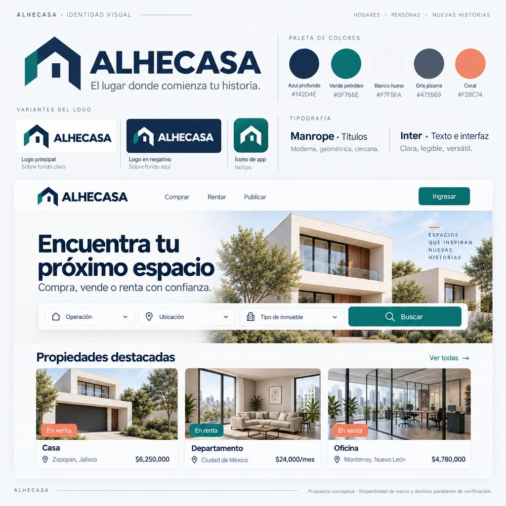

# Identidad visual

Referencia: 

La imagen es una **propuesta conceptual**: la disponibilidad de la marca y del dominio está pendiente de verificar.

**Lema:** «El lugar donde comienza tu historia.» · **Ejes:** hogares, personas, nuevas historias.

## Paleta

| Color | Hex | Uso en la aplicación |
|---|---|---|
| Azul profundo | `#142D4E` | Texto principal, menú lateral, logo, precios (`secondary`, `base-content`, `--menu-azul`) |
| Verde petróleo | `#0F766E` | Color de acción: botones principales, enlaces, renta (`primary`) |
| Blanco humo | `#F7F8FA` | Fondo de las pantallas y secciones (`base-200`) |
| Gris pizarra | `#475569` | Texto secundario y elementos neutros (`neutral`) |
| Coral | `#F28C74` | Acento puntual: etiqueta «En venta», línea decorativa (`accent`) |

Las tarjetas y campos van sobre blanco (`base-100`). Los estados (éxito, advertencia, error, información) usan colores propios con buen contraste, fuera de la paleta de marca.

## Tipografía

- **Manrope** (títulos, precios y nombre del logo): moderna, geométrica, cercana. Se aplica a `h1`–`h4`, a `.card-title` y a `font-display`.
- **Inter** (texto e interfaz): clara, legible, versátil. Es la fuente base (`font-sans`).

Ambas son variables y se sirven desde la propia aplicación (paquetes `@fontsource-variable/manrope` e `@fontsource-variable/inter`), sin pedir nada a servicios externos.

## Logo

Isotipo: una casa azul con una cinta verde petróleo a la izquierda y una ventana recortada. El nombre va en mayúsculas, Manrope extranegrita.

| Variante | Cuándo | Cómo se usa |
|---|---|---|
| Principal | Fondo claro (portada, login) | `<app-logo />` |
| En negativo | Fondo azul (menú lateral) | `<app-logo [negative]="true" />` |
| Ícono de app | Pestaña del navegador, accesos directos | `public/favicon.svg` (isotipo blanco sobre verde petróleo) |

`<app-logo>` acepta además `[markOnly]` (solo el isotipo, por ejemplo con el menú contraído), `[tagline]` (agrega el lema) y `size` (`sm`, `md`, `lg`). El isotipo es un SVG propio, dibujado a partir de la imagen: **no es el archivo original de la marca**. Si el diseñador entrega el SVG definitivo, se sustituye en `shared/components/logo/logo.ts` y en `public/favicon.svg`.

## Dónde vive en el código

- `web/src/styles.css`: tema de DaisyUI `alhecasa` (colores y radios: campos y selectores 0.5 rem, tarjetas 0.75 rem, sin sombras internas), fuentes y reglas de títulos. Es el único tema; `index.html` lo activa con `data-theme="alhecasa"`.
- `web/src/app/shared/components/logo/`: el componente del logo.
- `web/public/favicon.svg`: ícono de la pestaña.

## Criterios de uso

- El verde petróleo es el color de acción; el coral es un acento y no se usa para acciones ni para texto sobre blanco.
- Texto sobre verde petróleo y azul, siempre blanco. Texto sobre coral, siempre azul profundo.
- En la portada, «En venta» va en coral y «En renta» en verde petróleo.

## Pendiente

- Las fotografías de la propuesta (hero con arquitectura moderna, fotos de propiedades) no están en el repositorio: la portada todavía no las usa y las propiedades no tienen imágenes (el modelo no guarda fotos).
- Los enlaces «Comprar», «Rentar» y «Publicar» del encabezado de la propuesta no existen aún. Los filtros de operación, ubicación y tipo de inmueble sí están en la portada.
